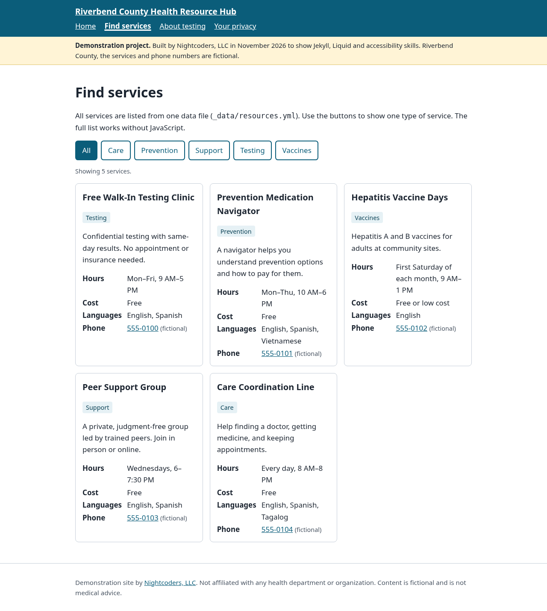

# Riverbend County Health Resource Hub — Jekyll demo

**Nightcoders demonstration project, built November 2026.** This is not client work. Riverbend County, its services and phone numbers are fictional. The site is not affiliated with any health department or organization and uses no third-party branding.

It shows how Nightcoders, LLC builds an accessible, plain-language public-health microsite with Jekyll and Liquid.

## What it shows

| Feature | Where |
|---|---|
| Resource listing built from a YAML data file | `_data/resources.yml` → `resources/index.html` |
| Reusable Liquid includes | `_includes/skip-link.html`, `header.html`, `resource-card.html`, `footer.html` |
| Skip link, landmarks, `aria-current` navigation | `_layouts/default.html`, `_includes/header.html` |
| Filter buttons with `aria-pressed` and a polite live-region count; full list still works without JavaScript | `resources/index.html` |
| Plain-language pages | `index.md`, `about-testing.md`, `privacy.md` |
| No cookies, trackers, analytics or forms | `privacy.md` |
| Visible focus outline, 44px targets, reduced-motion support | `assets/css/site.css` |

## Run locally

```bash
gem install jekyll -v "~> 4.3"   # or: bundle install
jekyll serve                      # http://127.0.0.1:4000/jekyll-health-hub/
```

## Publish on GitHub Pages

The site uses no plugins, so it builds with GitHub Pages' built-in Jekyll. In the repository go to **Settings → Pages → Build and deployment**, choose **Deploy from a branch**, pick `main` and `/ (root)`, then save. `baseurl` in `_config.yml` is `/jekyll-health-hub`, so the repository must be named `jekyll-health-hub` (or you change `baseurl`).

## Accessibility results (WCAG 2.1 AA)

Tested Nov 24, 2026 against a local build, with Google Chrome 156:

| Page | axe-core 4.14.1 (WCAG 2.0/2.1 A+AA and best-practice tags) | pa11y 10.0.0 (WCAG2AA; axe + HTML_CodeSniffer runners) |
|---|---|---|
| `/` | 0 violations, 35 passed rules, 0 needing review | No issues found |
| `/resources/` | 0 violations, 39 passed rules, 0 needing review | No issues found |
| `/about-testing/` | 0 violations, 35 passed rules, 0 needing review | No issues found |
| `/privacy/` | 0 violations, 35 passed rules, 0 needing review | No issues found |

Keyboard check (`scripts/keyboard-check.js`): the first Tab press focuses a visible “Skip to main content” link, and Enter moves focus to `<main>`.

The first axe run flagged one moderate `region` issue (the demo notice sat outside a landmark). It was moved inside the `<header>`, and the re-run was clean. Raw JSON results are in `a11y/`.

Automated tools find only part of the WCAG issues. A full audit would also include manual screen reader testing (NVDA/JAWS/VoiceOver), zoom and reflow to 400%, and content review.

Re-run the checks:

```bash
jekyll build -d /tmp/serve/jekyll-health-hub && (cd /tmp/serve && python3 -m http.server 4000 &)
npm i -g pa11y && npm i puppeteer-core axe-core
pa11y -c scripts/pa11y.json http://localhost:4000/jekyll-health-hub/resources/
node scripts/axe-run.js a11y http://localhost:4000/jekyll-health-hub/ http://localhost:4000/jekyll-health-hub/resources/
```

(Set `executablePath` in `scripts/pa11y.json` / `scripts/axe-run.js` to your Chrome if needed.)

## Screenshots



## License

MIT. Content is fictional sample text and is not medical advice.
